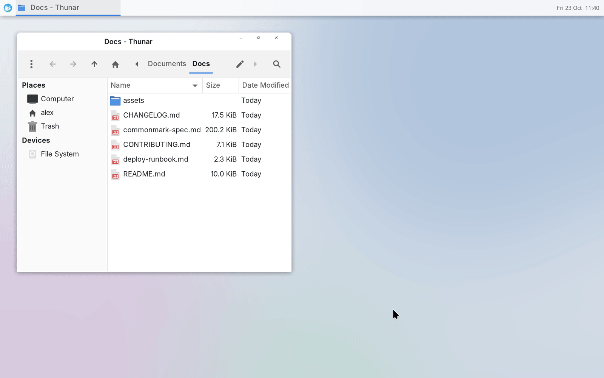
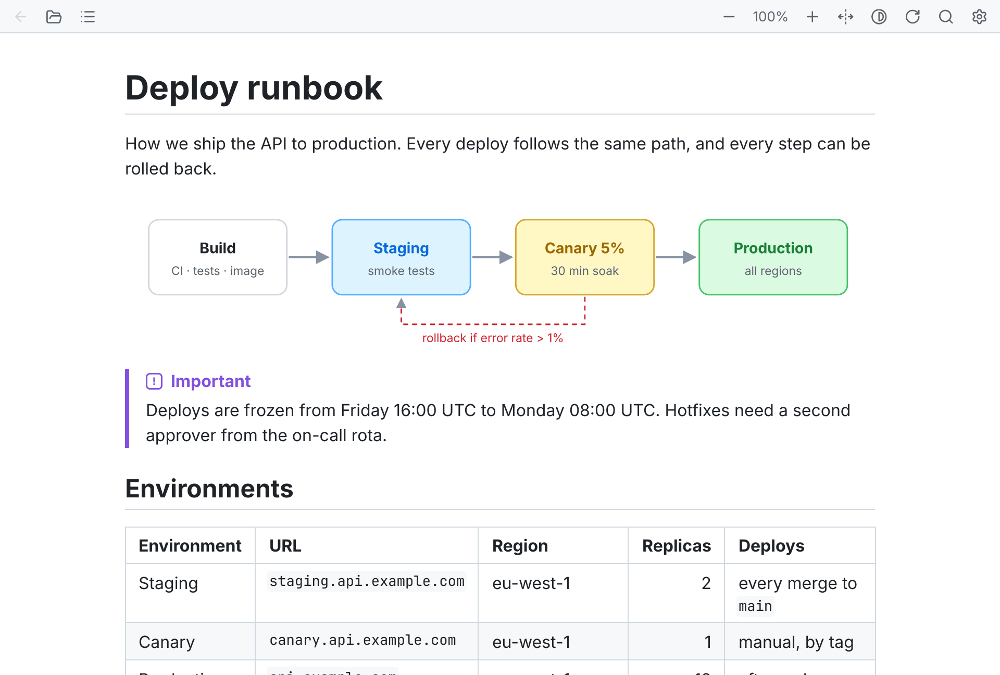

<p align="center">
  <picture>
    <source media="(prefers-color-scheme: dark)" srcset="assets/vomd-full-logo.svg">
    <source media="(prefers-color-scheme: light)" srcset="assets/vomd-full-logo-light.svg">
    
  </picture>
</p>

<p align="center">
  <a href="https://github.com/allenguarnes/vomd/releases/latest"></a>
  <a href="https://github.com/allenguarnes/vomd/actions/workflows/ci.yml"></a>
  <a href="#install"></a>
  <a href="LICENSE"></a>
</p>

<p align="center"><b>View-Only Markdown: a tiny, fast Markdown viewer for Linux and Windows.</b></p>

<p align="center">
  Double-click a <code>.md</code> file and it opens in well under a tenth of a second, rendered
  the way GitHub shows it.
</p>

<p align="center">
  <a href="#install">Install</a> |
  <a href="#keys">Keys</a> |
  <a href="#settings">Settings</a> |
  <a href="#privacy">Privacy</a> |
  <a href="CHANGELOG.md">Changelog</a> |
  <a href="CONTRIBUTING.md">Contributing</a>
</p>

<p align="center">
  
</p>

## Why VOMD

- **Fast.** Opens in milliseconds; a 5 MB document opens in under 100 ms.
- **Small.** One file with its fonts built in: 5.6 MB on Linux, 4.3 MB on Windows. No web
  engine, no GUI toolkit, nothing else to install.
- **Private.** Never touches the network unless you ask it to, and never runs a document's HTML.
- **Just a viewer.** No editor, no workspace, no accounts. Open a file, read it, close it.

## Features

- **GitHub-style Markdown:** CommonMark and GFM, with tables, task lists, footnotes, alerts
  (`> [!NOTE]`), autolinks and hidden YAML front matter.
- **Light and dark themes** that follow your system, zoom from 50% to 300%, and sharp text on
  HiDPI screens.
- **Images:** PNG, JPEG, GIF, WebP and SVG, local or remote. Animated GIFs and WebPs can play
  (off by default, press `A`).
- **Links:** `#anchors` scroll, links to other `.md` files open in the same window (with Back),
  and web links open in your browser.
- **Find in page** (`Ctrl+F`), a **contents panel** (`C`), and **text selection** with copy, plus a
  copy button on code blocks.
- **Live reload:** a file that changed on disk is shown again, at the same place, when you come
  back to the window.

<picture>
  <source media="(prefers-color-scheme: dark)" srcset="assets/screenshot-dark.png">
  
</picture>

## Install

| Platform | Download |
|---|---|
| Windows 10 (1803+) and 11 | [`vomd-<version>-x86_64-windows-portable.zip`](https://github.com/allenguarnes/vomd/releases/latest) |
| Debian 12+, Ubuntu 24.04+ | [`vomd_<version>-1_amd64.deb`](https://github.com/allenguarnes/vomd/releases/latest) |
| Any Linux (glibc 2.36+) | [AppImage](https://github.com/allenguarnes/vomd/releases/latest) or [tarball](https://github.com/allenguarnes/vomd/releases/latest) |
| Arch Linux | [Build with `makepkg`](#arch-linux) |

All builds are for x86-64.

### Windows

> [!IMPORTANT]
> **VOMD isn't code-signed yet, so Windows will probably warn you the first time you run it.**
> SmartScreen shows "Windows protected your PC" for any program from a publisher it doesn't know
> yet. It doesn't mean the file is harmful. Click **More info**, then **Run anyway**. You'll
> only see this once.

1. Download the portable zip from the [latest release](https://github.com/allenguarnes/vomd/releases/latest)
   and unzip it anywhere, such as your user folder.
2. Run `vomd.exe`, or drop a `.md` file on it.
3. To open `.md` files with VOMD: right-click one, choose **Open with** → **Choose another app**,
   pick `vomd.exe`, and select **Always**.

To remove VOMD, delete its folder (and `%APPDATA%\vomd`, if you made a settings file). It never
writes to the registry.

<details>
<summary>Check your download</summary>

Every zip is built from the tagged source by the public
[release workflow](https://github.com/allenguarnes/vomd/actions/workflows/release.yml), with a
`.sha256` file next to it. To check yours, run this and compare the result with that file:

```bat
certutil -hashfile vomd-<version>-x86_64-windows-portable.zip SHA256
```

</details>

### Debian and Ubuntu

Download the `.deb` from the [latest release](https://github.com/allenguarnes/vomd/releases/latest),
then:

```sh
sudo apt install ./vomd_*_amd64.deb
```

### AppImage

Works on any distribution with glibc 2.36 or newer:

```sh
chmod +x vomd-*-x86_64.AppImage
./vomd-*-x86_64.AppImage README.md
```

It needs FUSE (`fuse3`), which most desktops have; without it, add `--appimage-extract-and-run`.
To make it the app for `.md` files, use an integration tool such as Gear Lever or
AppImageLauncher. On a bare window manager without a desktop portal, `Ctrl+O` needs `zenity` or
`kdialog` installed.

### Tarball

```sh
tar xf vomd-*-x86_64-linux.tar.gz
cd vomd-*-x86_64-linux
install -Dm755 vomd ~/.local/bin/vomd
install -Dm644 vomd.desktop ~/.local/share/applications/vomd.desktop
install -Dm644 vomd.svg ~/.local/share/icons/hicolor/scalable/apps/vomd.svg
xdg-mime default vomd.desktop text/markdown   # open .md files with VOMD
```

<details>
<summary>If VOMD won't start: missing libraries</summary>

The AppImage and the tarball use your system's display libraries. Most desktops have them, but a
minimal install may not; `libxkbcommon-x11` is the one most often missing ("Library
libxkbcommon-x11.so could not be loaded"). On Debian and Ubuntu:

```sh
sudo apt install libwayland-client0 libxkbcommon0 libxkbcommon-x11-0 \
  libx11-6 libx11-xcb1 libxcb1 libxcursor1 libxi6
```

</details>

### Arch Linux

VOMD isn't on the AUR yet. Build the package from a clone:

```sh
git clone https://github.com/allenguarnes/vomd
cd vomd/packaging/aur/vomd-bin
makepkg -si
```

`vomd-bin` installs the release binary. `packaging/aur/vomd` builds from source with your
`makepkg.conf` instead.

### From source

With a stable Rust toolchain (on Windows, also the Visual Studio Build Tools with "Desktop
development with C++"):

```sh
cargo build --release
```

Smaller builds without some features are described in [CONTRIBUTING.md](CONTRIBUTING.md#cargo-features).

## Usage

```
vomd [FILE]          Open FILE (any extension is read as Markdown)
vomd -               Read Markdown from standard input
vomd                 Open an empty window (Ctrl+O opens a file)
vomd --no-settings   Ignore the settings file
```

Each window is its own process. The toolbar at the top has buttons for most of the keys below,
and ⚙ opens the settings file.

## Keys

| Key | Action |
|---|---|
| Wheel, `↑` `↓`, `j` `k` | Scroll |
| `PgUp` `PgDn`, `Space` | Scroll a page |
| `Home` `End`, `g` `G` | Top / bottom |
| `[` `]` | Previous / next heading |
| `Ctrl` + `=` `-` `0` | Zoom in / out / reset (also `Ctrl` + wheel) |
| `Ctrl+F` | Find (`Enter` / `Shift+Enter` for next / previous) |
| `C` | Contents panel |
| `T` | Theme: system → light → dark |
| `W` | Wide layout: text spans the whole window |
| `B` | Show / hide the toolbar |
| `I` | Load remote images for this document |
| `A` | Play / pause animated images |
| `R`, `F5` | Reload |
| `Backspace`, `Alt+←` | Back |
| `Ctrl+O` | Open a file |
| `Ctrl+A`, `Ctrl+C` | Select all, copy |
| `Esc` | Close what's open (menu, find bar, panel), else quit |
| `Q`, `Ctrl+W` | Quit |

**With the mouse:** drag to select, double-click for a word, triple-click for a paragraph, and
`Shift`+click to extend. Hover a code block for its copy button. Click an animated image to play
or pause just that one, or an image marked *click to load* to load it past VOMD's limits (hold
`Ctrl` if the image is a link). On Linux, selected text can also be pasted with a middle click.

## Settings

VOMD works without a settings file. To make one, click ⚙ in the toolbar: it creates the file with
every option listed and commented out. Changes apply as soon as you switch back to the window.

- Linux: `~/.config/vomd/settings.ini` (or `$XDG_CONFIG_HOME/vomd/settings.ini`)
- Windows: `%APPDATA%\vomd\settings.ini`

| Key | Values (default first) |
|---|---|
| `theme` | `system`, `light`, `dark` |
| `zoom` | `100` (50–300) |
| `font_size` | `16` (10–32) |
| `line_width` | `80` (40–200 characters) |
| `wide` | `false`, `true` |
| `toolbar` | `true`, `false` |
| `toc` | `false`, `true` (contents panel) |
| `animations` | `off`, `on` |
| `remote_images` | `ask`, `never`, `always` |
| `primary_selection` | `on`, `off` (Linux: middle-click paste of selected text) |
| `font_sans`, `font_mono` | `default` (built in), or an installed font such as `Noto Sans` |
| `window_width`, `window_height` | `900`, `1000` |

The theme, zoom, toolbar, contents panel, wide layout, animations and window size are saved
automatically when you change them.

## Privacy

VOMD makes no network requests of its own.

- **Remote images** stay as placeholders until you press `I` (or the toolbar's image button) for
  that document. They're then fetched with your system's `curl`, at most 12 MiB each, and kept in
  memory only. `remote_images = always` loads them for every document; `never` turns them off.
- **HTML** in a document is never run. Tags are removed and their text kept; a few, such as
  `<b>`, `` and `<a>`, are shown the way GitHub shows them.
- **SVGs** never load other files or URLs. Each one is drawn in a separate, short-lived process
  that is stopped if it takes too long.

## Limitations

- macOS isn't supported yet. The code compiles there, but it's untested.
- No screen reader support.
- Math and Mermaid diagrams show as plain text and code.
- AVIF, HEIC, BMP, TIFF and ICO images show their alt text.
- Drag and drop doesn't work on Wayland; use `Ctrl+O` there.
- Text can't be selected with the keyboard (`Shift` + arrows).
- On Windows, flag emoji show as two letters, as in other Windows apps.

## Contributing

Bug reports and pull requests are welcome. See [CONTRIBUTING.md](CONTRIBUTING.md) for how to build,
test and benchmark VOMD.

## AI disclosure

VOMD is developed with substantial help from AI, under the maintainer's direction:

- **Implementation:** most of the code, tests and documentation are written by open models,
  such as DeepSeek and GLM.
- **Advice and review:** Anthropic's Claude and OpenAI's Codex help with design and planning,
  and review the changes.

The maintainer decides what VOMD does and how it behaves, and what goes into each release.
Every change has to pass the test suite, the performance budgets and code review before it
ships.

## License

[MIT](LICENSE). The built-in fonts are Inter and JetBrains Mono (SIL OFL 1.1), and the icons are
from Lucide (ISC); their licenses are in [`assets/fonts/`](assets/fonts/).
