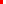
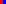
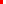
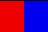
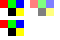
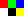

# Formats

GIF, first frame, transparent: 
WebP lossy  and lossless with alpha
.

SVG, drawn at the box:  
and with embedded images: 

Turned upright by EXIF:  (JPEG, 6)
 (PNG, 3)

``: 

``:

Over the limits: 
