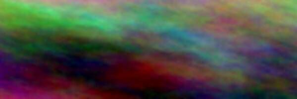

# Images

A local PNG with transparency, at its natural size:

A JPEG wider than half the column, then a progressive and a grayscale one inline:

Inline:  and  next to text.

A linked image: 

| Image in a table | Text |
|---|---|
|  | The image is no wider than its cell. |

Missing and unsupported images show their alt text: ,
, .

Remote images are blocked until `I`: 

